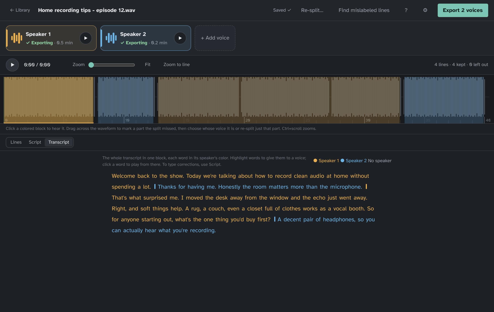
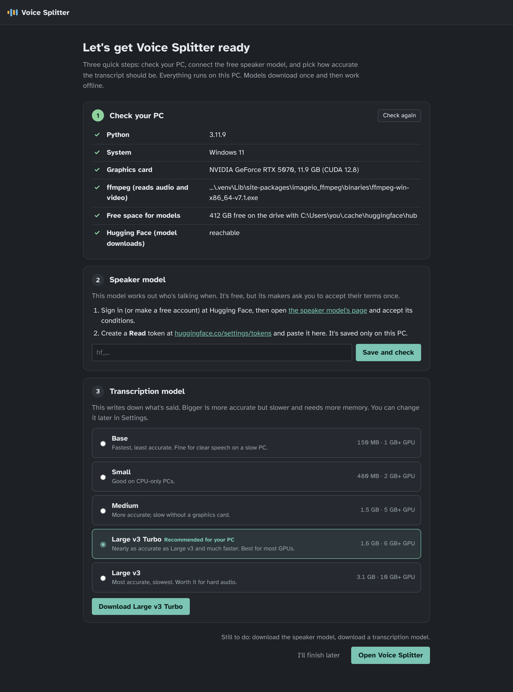
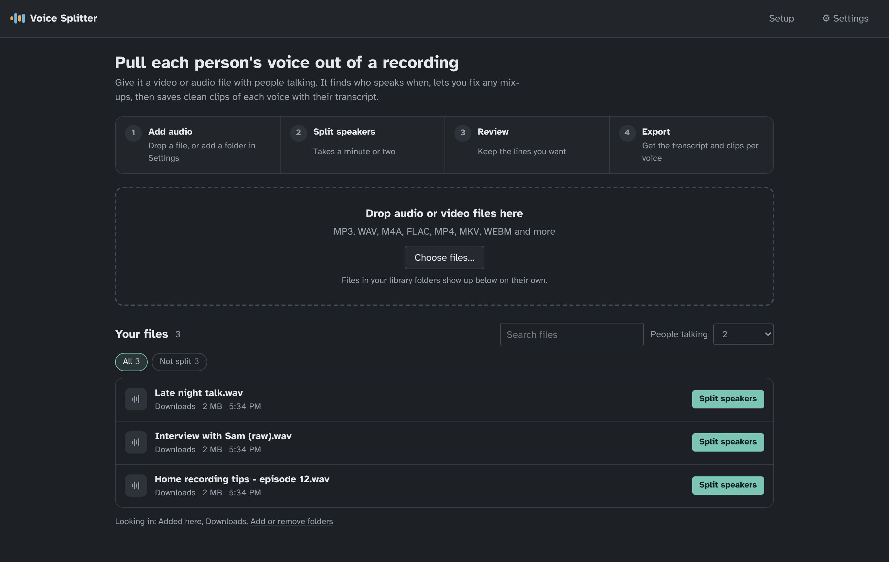
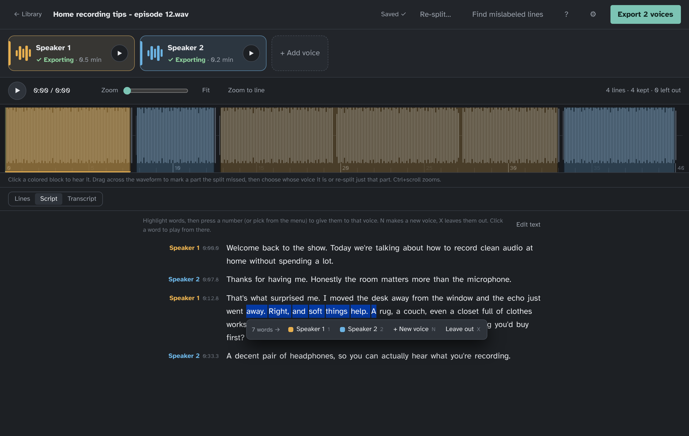

# Voice Splitter

Transcribe a recording, find who said what, fix any mistakes on a review
screen, and export clean clips per speaker, each with its transcript.

Everything runs on your PC. Your original files are never changed.



## What it does

- **Transcribes speech** from any audio or video file with
  [faster-whisper](https://github.com/SYSTRAN/faster-whisper), word by word
  with timings. Many languages are supported, and you can pick a faster or
  more accurate model to suit your PC.
- **Separates the speakers** with
  [pyannote.audio](https://github.com/pyannote/pyannote-audio), so every line
  of the transcript is labelled with who said it.
- **Lets you correct it:** read it as a list of lines, a script with the
  speaker beside each paragraph, or one block of text. Fix the words like a
  document, move lines to the right speaker, and re-split just the part that
  went wrong.
- **Exports** the whole conversation as `transcript.txt` and `transcript.srt`
  (subtitles), and clips for each speaker with a `dataset.list` of what was
  said in each one, in the format GPT-SoVITS reads.

## Install (Windows 10 or 11)

1. Download `voice-splitter-<version>.zip` from the
   [latest release](https://github.com/accipe1342/voice-splitter/releases/latest)
   and extract it to a folder of its own, for example `Documents\Voice Splitter`.
2. Double-click **`Start Voice Splitter.bat`**.

The first run installs what the app needs into that folder. It finds Python
3.10–3.12 or installs Python 3.11 for you, then installs PyTorch with GPU
support if you have an NVIDIA graphics card (the smaller CPU version
otherwise). Expect a few minutes and about 3 GB with a GPU, 1 GB without.
After that it starts in seconds.

Tip: right-click the `.bat` → **Send to → Desktop (create shortcut)**.

## First-run setup

The app then opens a setup page that walks you through three steps:

1. **Check your PC.** Python, graphics card, ffmpeg, free disk space and
   whether Hugging Face can be reached. Anything that needs fixing says how.
2. **Speaker model.** The speaker model is free, but it's gated: sign in at
   Hugging Face, accept the terms on
   [speaker-diarization-community-1](https://huggingface.co/pyannote/speaker-diarization-community-1),
   create a **Read** token at <https://huggingface.co/settings/tokens> and paste
   it in. The token is kept only on your PC (`secrets/hf_token.txt`).
3. **Transcription model.** Pick one; the one that suits your graphics card is
   marked *Recommended for your PC*.

| Model | Download | Best for |
|---|---|---|
| Base | 0.15 GB | Very slow PCs, clear speech |
| Small | 0.5 GB | PCs without an NVIDIA card |
| Medium | 1.5 GB | Graphics cards with 4–5 GB |
| Large v3 Turbo | 1.6 GB | Most graphics cards (6 GB or more) |
| Large v3 | 3.1 GB | Hard audio, when accuracy matters most |

You can come back to setup any time from the **Setup** link at the top of the
library.



## The workflow

1. **Add audio.** Drag in an MP3, WAV, M4A, FLAC, OGG or video file, or add a
   folder in **Settings → Library folders**. Files in those folders show up on
   their own.
2. **Split speakers.** Pick how many people are talking (or *auto*) and click
   **Split speakers**. The review screen opens when it's done.
3. **Review.** Skim the lines or the transcript and fix what's wrong.
4. **Export.** The full transcript (`transcript.txt` and `transcript.srt`),
   plus one folder per speaker with 2–12 second clips, a
   `dataset.list` in GPT-SoVITS format (each clip's file, speaker, language
   and text, separated by `|`) and a short preview of each person.



### Review screen

- **Voice cards** (top): one per person. Click a card to include or skip that
  voice in the export, click the name to rename it, ▶ plays a sample, and
  **+ Add voice** covers someone the split missed.
- **Waveform:** colored blocks are each voice. Drag a block's edges to trim
  it, drag on empty space to mark a new line, and zoom in with the slider or
  Ctrl+scroll.
- **Re-split a range:** select a stretch of the waveform and split just that
  part again. The rest of your edits stay, and **↶ Previous split** switches back.
- **Lines, Script and Transcript views:** Lines is a checklist, Script reads
  like a screenplay with the speaker beside each paragraph, and Transcript is
  one block of text. **Edit text** lets you correct the words like a document.
- **Filters:** show only lines to check, lines left out, or flagged lines.
- **Find mislabeled lines:** mark a few lines per voice as checked (select,
  press C), then run it. Lines that sound like someone else get a ⚠.
- Press **?** for keyboard shortcuts. Everything saves automatically, and
  Ctrl+Z undoes.



### Settings

**⚙ Settings** has your Hugging Face token, default speaker count and
language, transcription model, GPU or CPU, export clip lengths, the
voiceprint check, library folders, storage (delete old splits; originals are
never touched) and system information.

### Command line (optional)

```
.venv\Scripts\python voice_splitter.py split "file.mp3" --speakers 2
.venv\Scripts\python voice_splitter.py export <project-id>
```

## Where things live

```
Voice Splitter\
  Start Voice Splitter.bat   start here
  inbox\                     files you dragged in
  projects\<id>\             one per split file (audio, edits, export\)
  secrets\hf_token.txt       your Hugging Face token
  settings.json              your settings
```

Models are stored in the normal Hugging Face cache
(`%USERPROFILE%\.cache\huggingface`), shared with other apps that use it.

## Privacy and network use

Your audio, transcripts and token never leave your PC. The app goes online
only to:

- install Python packages during the first run (python.org/winget, PyPI and
  download.pytorch.org),
- check that huggingface.co is reachable and download the models you choose.

Once the models are downloaded, it works offline.

## Troubleshooting

- **Setup stopped with an error:** scroll up in the window for the message,
  fix it, and double-click the `.bat` again. It starts over cleanly.
- **"Python was installed but this window can't see it yet":** close the
  window and double-click the `.bat` again.
- **The GPU isn't used:** the setup page says why. If it says the CPU-only
  PyTorch is installed, delete the `.venv` folder and run the `.bat` again.
  RTX 50-series cards need the CUDA 12.8 build, which the installer uses. An
  old NVIDIA driver can also be the cause; update it from nvidia.com/drivers.
- **"Hugging Face refused the download":** accept the speaker model's terms
  on its page with the same account that made the token.
- **"ffmpeg not found":** the installer brings its own copy. If it's missing,
  delete `.venv` and run the `.bat` again, or put `ffmpeg.exe` on your PATH.
- **Splitting is slow:** on CPU, expect several minutes per hour of audio. A
  smaller transcription model helps.
- Clean audio in means clean clips out. Background music or heavy echo in the
  source carries into the clips.

## License

Voice Splitter is licensed under the [Apache License 2.0](LICENSE); see
[NOTICE](NOTICE) for bundled third-party parts. It uses
[pyannote.audio](https://github.com/pyannote/pyannote-audio) (speaker
detection), [faster-whisper](https://github.com/SYSTRAN/faster-whisper)
(transcription) and [wavesurfer.js](https://wavesurfer.xyz) (waveform). The
models are downloaded from Hugging Face and have their own licenses and
terms; see each model's page.
